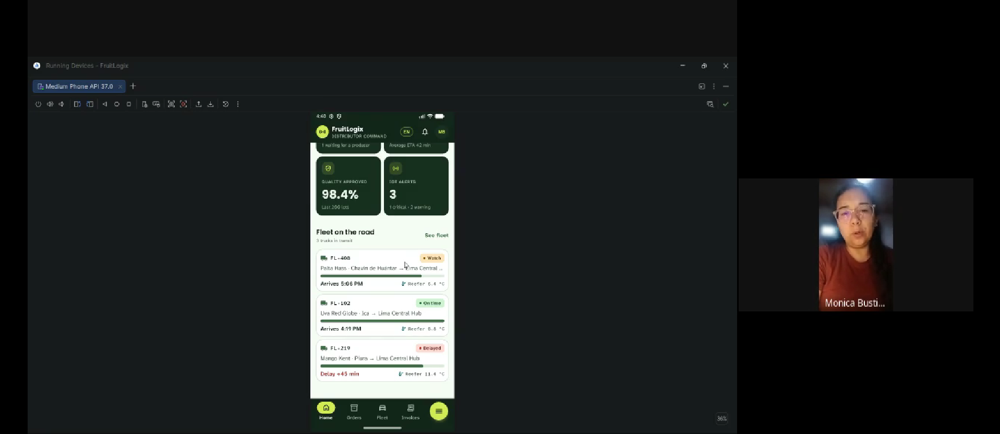

## 4.3. Validation Interviews
### 4.3.1. Diseño de entrevistas

El objetivo de estas entrevistas es probar las aplicaciones con personas pertenecientes a los segmentos objetivo para recibir retroalimentación que servirá para mejorar dichos componentes.

**Distribuidores de frutas:**
1.	¿Desde tu perspectiva de compra, considera que la información del dashboard es suficiente? ¿O piensas que le falta algo?
2.	Al tener un registro de contacto específico para cada pedido (con su número de orden visible en el encabezado), ¿sientes que ayuda a evitar confusiones al coordinar múltiples fundos a la vez?
3.	¿Qué información consideras indispensable que quede registrada en los detalles del pedido antes de aprobarlo (por ejemplo: placa del camión, confirmación de temperatura, hora exacta de llegada)?
4.	En la bandeja de entrada de las órdenes, ¿la identificación de las órdenes por pedido te permite mantenerte al tanto del estado del producto y te facilita la toma de decisión o evaluación?
5.	¿Consideras que toda esta dinámica de aceptación y contacto directo mitiga los problemas de unidades de transporte esperando en puerta de fundo sin producto listo?
6.  En una escala del 1 al 5, donde 1 es totalmente en desacuerdo y 5 totalmente de acuerdo, responda a estas afirmaciones:
   - "Me resultó claro y directo aceptar y consultar los pedidos en la aplicación."
   - "El canal de mensajería vinculado a la orden facilita la coordinación logística."

**Productores agrícolas:**
1.	Al revisar los pedidos pendientes en el panel y la tarjeta de acción rápida, ¿la información mostrada (kilos, cliente y límite de tiempo) te resulta suficiente para presionar directamente "Aceptar Pedido", o sueles necesitar revisar más condiciones antes de confirmar?
2.	En la pantalla de detalle del pedido (desglose de cajas/calibres y notas de frío), ¿falta algún dato operativo crítico que consideres indispensable antes de comprometer la fruta del galpón?
3.	Al interactuar con la app, ¿qué acción esperarías poder realizar si un pedido no se ajusta a tu stock disponible (por ejemplo, si te faltan kilos de mango), considerando que ahora la decisión principal es aceptar o coordinar?
4.	¿Qué tan intuitivo te resulta acceder a conversar con el distribuidor desde la lista de mensajes o desde la misma orden para coordinar la llegada del camión y horarios de recojo?
5.	Comparado con coordinar pedidos y recojos por llamadas o WhatsApp libre, ¿sientes que este flujo centralizado te ahorra tiempo o reduce confusiones de despacho?

### 4.3.2. Registro de entrevistas

### Segmento objetivo: Clientes Comerciales

### Segmento objetivo: Productores Agrícolas

### Segmento objetivo: Distribuidores de frutas

URL de las entrevistas: https://drive.google.com/file/d/1w0Mo4FoCXfyr-G8KAebsLMfk5TKq_PfO/view?usp=drive_link

| Campo |   Entrevista 1 |   Entrevista 2 |   Entrevista 3 |
|---|-----------------------------------------------------------------------------|------------------------------------------------------------------------|---------------------------------------------------------------------------|
| **Nombre** | Monica Bustinza                                                             |                                                           |                                                                |
| **Edad** | 32 años                                                                     |                                                                 |                                                                   |
| **Distrito** | Lince                                                                       |                                                      |                                                                     |
| **Duración** | 0:00 - 13:12                                                                |                                                           |                                                          |

**Resumen – Monica Bustinza**

Durante la entrevista a Monica Bustinza, distribuidora de frutas de 32 años, se pudo probar tanto la Landing Page de FruitLogix como la aplicación en Jetpack Compose orientada a distribuidores. Respecto a la Landing Page, a Monica le gustó el diseño, y consideró que la información era completa y explicaba adecuadamente lo necesario para operar como distribuidora. Posterior a ello, se mostró la aplicación, frente a la cual Monica respondió que proporciona un flujo claro y rápido, reduciendo errores frente al uso de papeles. Igualmente, dejó sugerencias como añadir un canal de comunicación directa con el productor para consultar detalles específicos por presentaciones de productos antes de seleccionar al proveedor, así como incluir información indispensable respecto al conductor como la configuración de temperatura, hora de llegada y datos personales antes de seleccionarlo.
